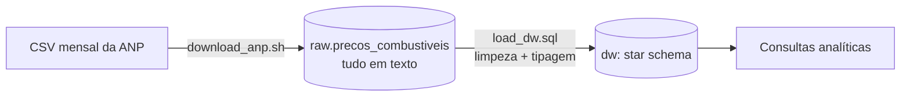

# ⛽ Fuel Price Warehouse


Data warehouse dimensional dos **preços de combustíveis praticados nos postos do Brasil**, a partir dos dados abertos da ANP.

> **Por que esse projeto?** Combustível é o maior custo variável de uma frota. Antes de qualquer dashboard, alguém precisa transformar milhões de linhas de CSV num modelo confiável e rápido de consultar. É isso que este repositório faz.

Parte 1 de 3 do portfólio **Custo de frota no Brasil**:
1. **fuel-price-warehouse** (este): modelagem e SQL
2. [economic-indicators-etl](https://github.com/GustavoCabral22/economic-indicators-etl): ingestão de indicadores do Banco Central em Python
3. [fleet-cost-pipeline](https://github.com/GustavoCabral22/fleet-cost-pipeline): orquestração com Airflow

## Arquitetura



- **raw**: cópia fiel do arquivo, com o nome do arquivo de origem. Recarregar o mesmo arquivo substitui a versão anterior.
- **dw**: modelo estrela com 1 fato e 4 dimensões. Detalhes e decisões em [docs/modelo.md](docs/modelo.md).

## Como rodar

Pré-requisitos: Docker e `psql` (cliente PostgreSQL).

```bash
make up         # sobe o PostgreSQL e cria o schema
make sample     # carrega uma amostra sintética (não precisa de internet)
make analyses   # roda as 5 análises
```

Para usar dados reais da ANP:

```bash
make load ANO=2025 MES=03
```

> A amostra em `data/sample/` é **sintética** (gerada por `scripts/generate_sample.py`) e existe só para o projeto rodar sem download. Os números dela não representam a realidade.

## Perguntas que o warehouse responde

| Arquivo | Pergunta | Técnica SQL |
|---|---|---|
| [01_variacao_mensal](sql/analysis/01_variacao_mensal.sql) | Quanto cada combustível variou mês a mês? | `LAG()`, cláusula `WINDOW` |
| [02_municipios_mais_caros](sql/analysis/02_municipios_mais_caros.sql) | Onde está o diesel mais caro no último mês? | `RANK()`, `HAVING` com amostra mínima |
| [03_media_movel_uf](sql/analysis/03_media_movel_uf.sql) | Qual a tendência da gasolina por estado? | Média móvel com `ROWS BETWEEN` |
| [04_bandeira_branca](sql/analysis/04_bandeira_branca.sql) | Posto sem bandeira é mesmo mais barato? | Agregação condicional com `FILTER` |
| [05_dispersao_uf](sql/analysis/05_dispersao_uf.sql) | Onde o preço varia mais entre postos? | `PERCENTILE_CONT`, amplitude interquartil |

## Boas práticas aplicadas

- **Idempotência:** todas as cargas usam `ON CONFLICT`. Rodar duas vezes dá o mesmo resultado, e o CI prova isso a cada push.
- **Separação raw / dw:** a carga nunca quebra por um valor mal formatado; a limpeza é explícita e versionada.
- **Infra como código:** o banco sobe com um comando e o schema é criado automaticamente.
- **CI no GitHub Actions:** cria o schema, carrega a amostra, confere duplicação e roda todas as análises.

## Estrutura

```
├── sql/
│   ├── ddl/          # schemas, tabelas e dimensão tempo (rodam na subida do banco)
│   ├── transform/    # raw -> dw
│   └── analysis/     # perguntas de negócio
├── scripts/          # download, carga e gerador da amostra
├── data/sample/      # amostra sintética
└── docs/modelo.md    # diagrama e decisões de modelagem
```

## Próximos passos

- [ ] `dim_revenda` como SCD tipo 2 (manter histórico de troca de bandeira)
- [ ] Migrar a transformação para **dbt**, com testes de qualidade declarativos
- [ ] Particionar a fato por ano quando a série histórica completa for carregada

## Fonte dos dados

[ANP: Série histórica de preços de combustíveis](https://www.gov.br/anp/pt-br/centrais-de-conteudo/dados-abertos/serie-historica-de-precos-de-combustiveis), dados abertos do Governo Federal.
