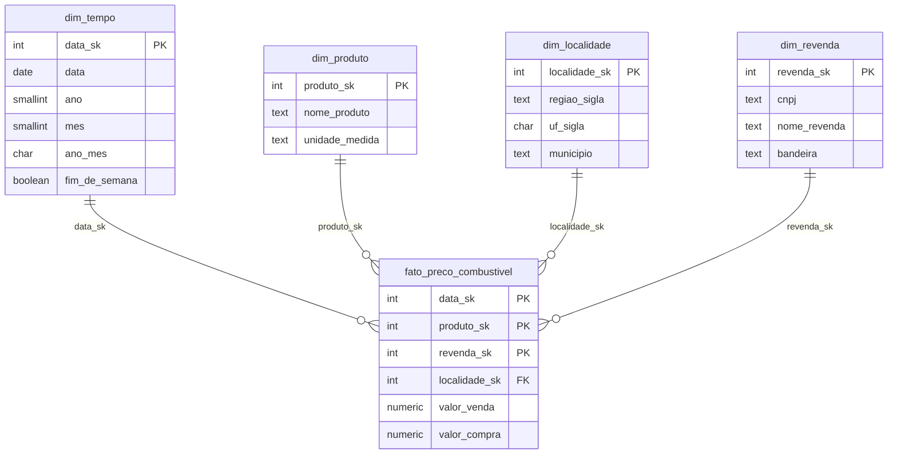

# Modelo de dados

## Decisões de modelagem

| Decisão | Motivo |
|---|---|
| **Grão:** 1 linha por produto, posto e dia | É o menor nível que a ANP publica. Agregar depois é fácil; desagregar é impossível. |
| **Camada `raw` toda em texto** | A carga nunca falha por causa de um valor mal formatado. A limpeza fica na transformação, onde dá para tratar. |
| **Chaves substitutas (`_sk`)** | Desacopla o warehouse das chaves da fonte e deixa os joins em inteiros. |
| **`dim_tempo` gerada, não carregada** | Garante todos os dias do calendário, inclusive os sem coleta. |
| **`localidade` separada de `revenda`** | Muitas análises são por município/UF e não precisam passar pela dimensão de postos. |
| **`dim_revenda` como SCD tipo 1** | Simples. Se o posto trocar de bandeira, o histórico se perde: a evolução natural é SCD tipo 2. |
| **`ON CONFLICT` em todas as cargas** | Rodar a mesma carga duas vezes dá o mesmo resultado (idempotência). |
